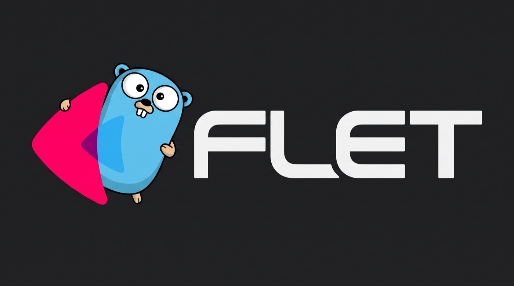

<p align="center">
  
</p>

<h3 align="center">Build cross-platform apps in Python — and now in Go.<br>No frontend experience required.</h3>

<p align="center">
  <a href="docs/getting-started.md">Getting started</a> ·
  <a href="docs/README.md">Documentation</a> ·
  <a href="examples/">Examples</a> ·
  <a href="CONTRIBUTING.md">Contributing</a>
</p>

---

> **🚧 Early stage.** flet-go is young and its API may still change. Bug reports,
> ideas, docs, examples and pull requests are all welcome. See
> [CONTRIBUTING.md](CONTRIBUTING.md).

**flet-go** lets you write user interfaces in Go and have them rendered by
[Flet](https://flet.dev)'s Flutter client. You write plain Go — structs, functions
and goroutines — and get a native-looking app on the desktop or in the browser,
with Material and Cupertino controls, themes, dialogs and navigation.

It is a Go SDK for the existing Flet client: the same client that powers Flet for
Python, now driven from Go.

```go
package main

import (
	"strconv"

	flet "github.com/srcarvalho12/flet-go"
	"github.com/srcarvalho12/flet-go/icons"
)

func main() {
	flet.App(func(page *flet.Page) {
		page.Title = "Counter"
		count := 0
		value := &flet.Text{Value: "0", Size: 40}

		change := func(delta int) func(*flet.Event) {
			return func(*flet.Event) {
				count += delta
				value.Value = strconv.Itoa(count)
				page.Update() // sends only what changed
			}
		}

		page.Add(&flet.Row{
			Alignment: flet.MainAxisAlignmentCenter,
			Controls: []flet.Control{
				&flet.IconButton{Icon: icons.Remove, OnClick: change(-1)},
				value,
				&flet.IconButton{Icon: icons.Add, OnClick: change(+1)},
			},
		})
	})
}
```

Run it with `go run .` and a window opens. Change `flet.App(main)` to
`flet.Serve(":8550", main)` and the same app runs in the browser.

## Features

- **150+ controls** generated from the Flet SDK: layout, inputs, lists, cards,
  dialogs, navigation bars, Cupertino controls and more, plus ~10k icons and the
  Material colors.
- **Desktop and web** from the same code. On the web, every browser tab gets its
  own session, which survives reloads and short disconnections.
- **Router** with pages in their own files, path parameters, shared layouts,
  middleware (e.g. login), stacked screens with a back arrow, and the browser's
  back button and deep links working out of the box.
- **Client methods** as plain Go calls: `field.Focus()`, `clipboard.Get()`,
  `picker.PickFiles(...)`, `page.Window.Center()`.
- **Efficient updates:** `page.Update()` compares with what the client already
  has and sends only the difference.
- **Go-friendly concurrency:** handlers run one at a time per page, and
  `page.Run` lets other goroutines update the UI safely.
- **Web extras:** base paths (`/app/`), signed file uploads, your own assets
  folder, and an `http.Handler` to mount in an existing server.

## Install

```bash
go get github.com/srcarvalho12/flet-go
```

Requires Go 1.27 or newer. On the first run, the Flet client (desktop or web) is
downloaded once and cached. Automatic download works on macOS and Windows for the
desktop client and on every OS for the web client.

## How it works

```
┌──────────────────────┐       messages       ┌──────────────────────┐
│       Your Go app    │  ─── add/update ───▶ │  Flet Flutter client │
│     control tree     │                      │   renders widgets    │
│   diff + handlers    │  ◀──── events ────── │     sends events     │
└──────────────────────┘  socket / WebSocket  └──────────────────────┘
```

All state and logic live in Go. The client only renders and reports what the
user does. See [docs/architecture.md](docs/architecture.md).

## Status

| Area | Status |
|---|---|
| Desktop (macOS, Windows) | ✅ Works |
| Web (server-backed) | ✅ Works |
| Router, layouts, sessions | ✅ Works |
| Web production build (`flet-go build web`) | 🔜 Next |
| Linux desktop download | 🔜 Planned (use `FLET_CLIENT_PATH` for now) |
| Android and iOS | 🔜 Planned |
| Extension packages (charts, maps, video…) | 🔜 Planned |

The detailed plan and design notes are in [PLAN.md](PLAN.md).

## Documentation

- [Getting started](docs/getting-started.md)
- [Controls, events and methods](docs/controls.md)
- [Pages, dialogs, services and state](docs/page.md)
- [Routing](docs/routing.md)
- [Web apps](docs/web.md)
- [Desktop apps](docs/desktop.md)
- [Architecture](docs/architecture.md)

## Contributing

The project is in its early days and every kind of help counts: trying it out and
opening issues, improving docs, writing examples, or picking an item from the
roadmap. Start with [CONTRIBUTING.md](CONTRIBUTING.md).

## Acknowledgements

flet-go is built on [Flet](https://github.com/flet-dev/flet), by the Flet team and
contributors. The Flet client is downloaded from the official Flet
releases, and the controls are generated from the Flet Python SDK (Apache License
2.0). flet-go is an independent project, not affiliated with the Flet team.
